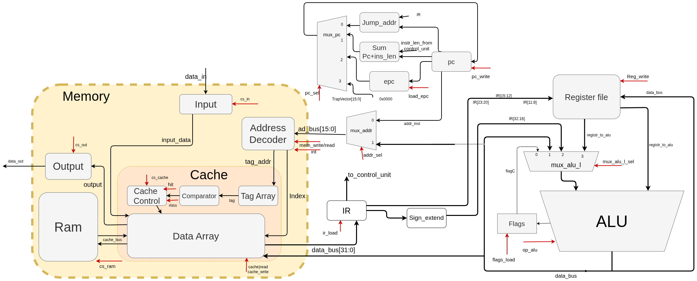
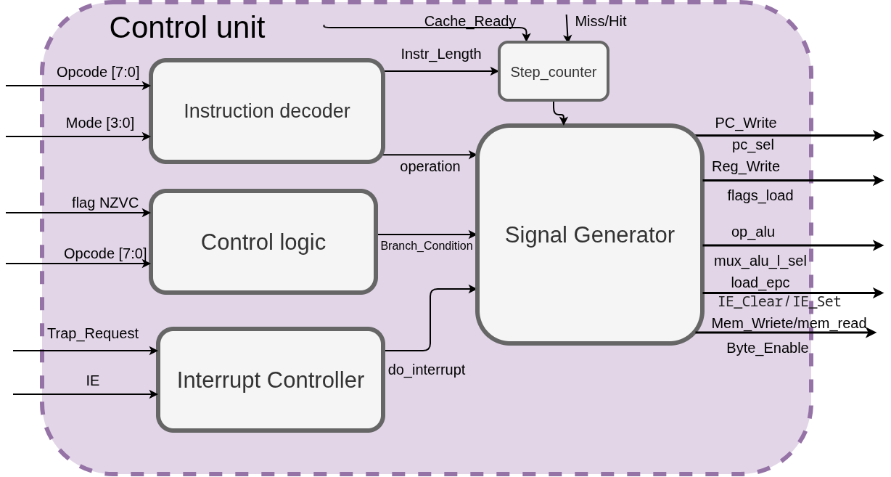

# Лаб 4 

- Розова Елена Алексеевна P3210
- `alg | cisc | neum | hw | trap | mem | pstr | cache | alg1`


## Язык программирования
```bnf
<program>      ::= "interrupt" "{" <stmt_list> "}" <stmt_list>
<stmt_list>    ::= <stmt> | <stmt> <stmt_list> | ε
<stmt>         ::= <let_decl> | <assign> | <if_stmt> | <while_stmt> | <print_stmt>
<let_decl>     ::= "let" <var> "=" <expr>
<assign>       ::= <var> "=" <expr>
<if_stmt>      ::= "if" "(" <cond> ")" "{" <stmt_list> "}" ["else" "{" <stmt_list> "}"]
<while_stmt>   ::= "while" "(" <cond> ")" "{" <stmt_list> "}"
<print_stmt>   ::= "print_byte" "(" <expr> "," <expr> ")"
<cond>         ::= <expr> <cmp_op> <expr>
<cmp_op>       ::= "==" | "!=" | "<" | ">" | "<=" | ">="
<expr>         ::= <number> | <var> | <read_call> | <expr> <arith_op> <expr>
<arith_op>     ::= "+" | "-" | "*" | "/" | "%" | "&" | "|"
<read_call>    ::= "read_byte" "(" <expr> ")"
<var>          ::= [a-zA-Z_][a-zA-Z0-9_]*
<number>       ::= [0-9]+ | "0x"[0-9A-Fa-f]+
```
Код выполняется последовательно, сверху вниз. Операции:
- `let x = <expr>` — объявить переменную, вычислить выражение, сохранить результат в ячейку памяти (0x3000+)
- `x = <expr>` — вычислить выражение, записать в уже существующую переменную
- `if (cond) { ... } else { ... }` — вычислить условие, при истинности выполнить первый блок, иначе второй
- `while (cond) { ... }` — вычислять условие и тело, пока оно истинно
- `break` — досрочный выход из ближайшего цикла (транслируется в безусловный переход jmp за пределы тела)
- `print_byte(val, port) / print_word(val, port)` — записать значение в порт вывода (0x84)
- `read_byte(addr) / read_word(addr)` — считать значение из порта ввода (0x80) или памяти
- `interrupt { ... }` — блок обработчика прерываний; размещается по адресу 0x0000, завершается автоматически командой reti.

#### Семантика

**Стратегия вычислений:** строгая (call-by-value). Все выражения вычисляются до присваивания. Операции выполняются последовательно, слева направо. Из-за ограничений транслятора в одном выражении допускается не более одного бинарного оператора; сложные выражения разбиваются на несколько `let`.

**Области видимости:** глобальные. Все переменные видны во всей программе, включая блок `interrupt`. Переменные объявляются через `let` и размещаются в статической памяти начиная с адреса `0x3004`.

**Типизация:** динамическая, один базовый тип — 32-битное знаковое целое число (дополнительный код). Явные преобразования типов отсутствуют. Строки трактуются как последовательности байт в памяти.

**Виды литералов:**
-   Числовые: десятичные (`42`), шестнадцатеричные (`0x3000`), отрицательные (`-1`). При размере ≤ 8 бит кодируются как immediate (MODE 1), ≤ 16 бит — как immediate (MODE 2), иначе сохраняются в статическую память.
-   Строковые: `"text"` — сохраняются в память как Pascal-строки (первый байт — длина, далее символы ASCII).
-   Специальные: переменная `count` зарезервирована по адресу `0x3000`, объявлять её через `let` нельзя.

**Отображение выражений на регистры:** Сложные выражения разбиваются транслятором на простые операции. Каждая операция использует регистры `r0` (результат) и `r3` (второй операнд). Промежуточные результаты сохраняются в память по адресам переменных.
Пример:
```
let x = a + b
```
Транслируется в:
```asm
load r0, [addr_a]    ; a
load r3, [addr_b]    ; b
add  r0, r0, r3      ; r0 = a + b
store [addr_x], r0   ; x = r0
```


---
## Организация памяти
#### Модель памяти процессора
Архитектура: фон Неймановская (neum) — единое адресное пространство для команд и данных.
Основные параметры:
- Размер машинного слова: 32 бита (4 байта)
- Адресация: байтовая, 16-битные адреса (64 КБ адресуемой памяти)
- Порядок байт: little-endian
- Тип памяти: однопортовая (либо чтение, либо запись за один такт)

#### Регистровый файл
*   **R0–R7:** Регистры общего назначения (32 бита)
*   **PC:** Счётчик команд
*   **EPC:** Регистр для сохранения адреса прерванной команды при возникновении прерывания
*   **IR:** Регистр текущей инструкции
*   **Flags:** Флаги состояния АЛУ (Z — ноль, N — отрицательный, C — перенос, V — переполнение)
*   **IE:** Флаг прерываний
*   **R_INT:** Специальный регистр данных прерывания (32 бита). При возникновении прерывания модель автоматически помещает доступный токен из порта ввода (`0x0080`) в этот регистр. Обработчик прерывания считывает данные именно из `R_INT` и сохраняет их в память. Это архитектурное решение гарантирует сохранность контекста регистров общего назначения (`R0`–`R7`), используемых основной программой.

#### Карта памяти

| Диапазон адресов | Назначение | Описание |
| :--- | :--- | :--- |
| **`0x0000` – `0x007F`** | **Обработчик прерываний** | Сюда транслятор размещает код из блока `interrupt { ... }`. Точка входа при прерывании — `0x0000`. |
| **`0x0080`** | **Порт ввода (MMIO)** | Специальный адрес. Чтение (`load`) инициирует запрос токена у модели. |
| **`0x0084`** | **Порт вывода (MMIO)** | Специальный адрес. Запись (`store`) отправляет токен в буфер вывода модели. |
| **`0x0088` – `0x00FF`** | **Векторы прерываний / резерв** | Свободная зона для будущих расширений. |
| **`0x0100` – `0x1FFF`** | **Код основной программы** | Сюда транслируются инструкции основной программы. Начало выполнения: `0x0100`. |
| **`0x2000` – `0x2FFF`** | **Статические данные** | Строковые литералы (Pascal-строки) и крупные числовые константы, не помещающиеся в непосредственную адресацию. |
| **`0x3000` – `0x3FFF`** | **Глобальные переменные** | Область для переменных, объявленных через `let`. Выравнивание: 4 байта для слов, 1 байт для символов. |
| **`0x4000` – `0x5FFF`** | **Буфер ввода (`trap`)** | Область, куда обработчик прерываний посимвольно сохраняет входящие данные. |
| **`0x6000` – `0x6FFF`** | **Временные буферы** | Используется алгоритмами для промежуточных вычислений (например, инверсия цифр при преобразовании числа в строку). |


Механика отображения программы и данных
#### 1. Инструкции и прерывания
##### Обработчик прерываний:
- Размещается транслятором по адресу 0x0000 (вектор прерывания).
- Код из блока interrupt { ... } в языке компилируется в эту область.
- При возникновении прерывания процессор автоматически переходит по адресу 0x0000.
- Транслятор автоматически генерирует пролог (сохранение R0–R3 в 0x0088–0x00FF) и эпилог (восстановление + reti).
##### Основная программа:
- Размещается начиная с адреса 0x0100.
- Транслятор вставляет инструкцию int_enable перед первой инструкцией основной программы.
- Инструкции имеют переменную длину (1, 3, 4 или 5 байт) в зависимости от режима адресации.

#### 2. Переменные
##### Глобальные переменные:
- Все переменные, объявленные через let, размещаются в области 0x3004–0x3FFF.
- Выравнивание: 4 байта (одно машинное слово на переменную).
- Переменная count зарезервирована по адресу 0x3000 и используется для подсчёта байт, принятых через прерывания. - Объявлять её через let нельзя.
##### Отображение на регистры:
- В данной архитектуре регистровый аллокатор не используется.
- Все переменные хранятся в статической памяти (0x3000+).
- Регистры R0–R7 используются как временные аккумуляторы для вычислений
- Ситуация нехватки регистров не возникает, так как каждая операция использует фиксированный набор регистров.

#### 3. Литералы
##### Строковые литералы (Pascal-строки):
- Формат: первый байт — длина строки, далее символы по одному байту (ASCII).
- В текущей реализации компилятора строковые литералы размещаются в области переменных (0x3000+), а не в выделенной секции 0x2000–0x2FFF.
- Обоснование: используется единая таблица символов symbol_table, что упрощает трансляцию. Все литералы аллоцируются последовательно, в порядке появления в исходном коде.
- Размещение: побайтно в непрерывной области памяти.
- Выравнивание до 4 байт не применяется (символы идут подряд).
##### Литералы, требующие несколько машинных слов:
- Размещаются побайтно в непрерывной области памяти.
- Доступ осуществляется через адрес первого байта + смещение.

#### 4. Ввод-вывод (Memory-Mapped I/O)
##### Порт ввода (0x0080):
- При чтении (load r0, [0x80]) симулятор возвращает значение регистра R_INT.
- R_INT заполняется аппаратно при возникновении прерывания (значение из расписания ввода).
- Обработчик прерывания считывает R_INT и сохраняет данные в буфер 0x4000+.
##### Порт вывода (0x0084):
- При записи (store_byte [0x84], r0) символ добавляется в буфер вывода симулятора.

#### 5. Кэш-память 
##### Параметры:
- Организация: direct-mapped.
- Размер кэш-линии: 4 байта.
- Количество линий: 16.
- Скорость доступа: 1 такт (HIT), 10 тактов (MISS).
##### Адресация в кэше:
* Адрес делится на три поля:
  - Tag — старшие биты (сравнение с Tag Array).
  - Index — средние биты (выбор линии).
  - Offset — младшие 2 бита (выбор байта в строке).
##### При MISS:
- Загружается весь блок (4 байта) из RAM за 10 тактов.
- Блок сохраняется в кэш-линии с соответствующим tag.
##### При HIT:
- Данные возвращаются за 1 такт.

---
## Система команд

### Особенности процессора

**Архитектура:** фон Неймановская

**Тип системы команд:** CISC

**Управление:** Hardwired

### Типы данных и машинные слова

- **Размер машинного слова:** 32 бита (4 байта).
- **Порядок байт:** little-endian.
- **Адресация:** байтовая, 16-битные адреса (64 КБ адресуемой памяти).
- **Базовый тип данных:** 32-битное знаковое целое число (дополнительный код).

### Устройство памяти и регистров

**Регистровый файл:**
- **R0–R7** — регистры общего назначения (32 бита каждый).
- **PC** (Program Counter) — счётчик команд (16 бит).
- **EPC** (Exception PC) — адрес возврата из прерывания (16 бит).
- **IR** (Instruction Register) — регистр текущей инструкции (40 бит, до 5 байт).
- **R_INT** — специальный регистр данных прерывания (32 бита, read-only). При возникновении прерывания процессор аппаратно помещает токен из порта ввода в этот регистр.
- **Flags** — регистр флагов состояния АЛУ (4 бита):
  - **Z** (Zero) — результат операции равен нулю.
  - **N** (Negative) — старший бит результата установлен (отрицательное число).
  - **C** (Carry) — перенос при сложении/заём при вычитании.
  - **V** (Overflow) — знаковое переполнение.
- **IE** (Interrupt Enable) — флаг разрешения прерываний (1 бит).

**Кэш-память** (усложнение `cache`):
- **Организация:** direct-mapped.
- **Параметры:** 16 линий, размер строки 4 байта.
- **Скорость доступа:** HIT = 1 такт, MISS = 10 тактов (загрузка блока из RAM).

### Устройство ввода-вывода

**Memory-Mapped I/O (`mem`):** порты ввода-вывода отображены в адресное пространство памяти и доступны через штатные команды `load`/`store`.

| Адрес | Назначение |
|-------|------------|
| `0x0080` | Порт ввода (Input Port). Чтение возвращает значение из регистра `R_INT`. |
| `0x0084` | Порт вывода (Output Port). Запись отправляет символ в буфер вывода. |

### Поток управления и система прерываний

**Поток управления:**
- Инкремент PC после каждой инструкции на величину `instr_len` (1, 3, 4 или 5 байт в зависимости от режима адресации).
- Безусловные (`jmp`) и условные (`jeq`, `jne`, `jlt`, `jgt`) переходы по *абсолютному* 16-битному адресу.

**Система прерываний (`trap`):**
- Прерывания внутренние, обработчик реализуется программистом на языке `kot`.
- При возникновении прерывания (сигнал от симулятора по расписанию) и если `IE = 1`:
  1. Текущий PC сохраняется в EPC.
  2. IE сбрасывается в 0 (запрет вложенных прерываний).
  3. PC загружается адресом вектора прерывания (`0x0000`).
  4. Значение из порта ввода аппаратно помещается в R_INT.
  5. Выполняется обработчик прерывания.
  6. Завершение обработчика — команда `reti`, которая восстанавливает PC из EPC и устанавливает IE = 1.
- Ситуация прерывания во время обработки прерывания: процессор логирует событие, но не прерывает текущий обработчик (вложенные прерывания запрещены).

---

## Набор инструкций

### Арифметические и логические операции

| Мнемоника | Опкод | Допустимые MODE | Кол-во тактов | Описание |
|-----------|-------|-----------------|---------------|----------|
| `add` | 0x00 | 0, 1, 2, 3, 4, 5, 6 | 1 | Rd = Rs + Op2 |
| `sub` | 0x01 | 0, 1, 2, 3, 4, 5, 6 | 1 | Rd = Rs − Op2 |
| `adc` | 0x02 | 0, 1, 2 | 1 | Rd = Rs + Op2 + C (сложение с переносом) |
| `mul` | 0x03 | 0, 1 | 1 | Rd = Rs × Op2 |
| `div` | 0x04 | 0, 1 | 1 | Rd = Rs / Op2 (целочисленное деление) |
| `mod` | 0x05 | 0, 1 | 1 | Rd = Rs % Op2 (остаток от деления) |
| `and` | 0x06 | 0, 1 | 1 | Rd = Rs & Op2 (побитовое И) |
| `or` | 0x07 | 0, 1 | 1 | Rd = Rs \| Op2 (побитовое ИЛИ) |
| `lsl` | 0x08 | 1 | 1 | Rd = Rs << imm (логический сдвиг влево) |
| `lsr` | 0x09 | 1 | 1 | Rd = Rs >> imm (логический сдвиг вправо) |

### Работа с памятью и строками

| Мнемоника | Опкод | Допустимые MODE | Кол-во тактов | Описание |
|-----------|-------|-----------------|---------------|----------|
| `load` | 0x10 | 0, 2, 3, 4, 5, 6 | 1 (HIT) / 10 (MISS) | Загрузка 32-битного слова из памяти |
| `store` | 0x11 | 3, 4, 5, 6 | 1 (HIT) / 10 (MISS) | Сохранение 32-битного слова в память |
| `load_byte` | 0x12 | 3, 4, 5, 6 | 1 (HIT) / 10 (MISS) | Загрузка 1 байта из памяти |
| `store_byte` | 0x13 | 3, 4, 5, 6 | 1 (HIT) / 10 (MISS) | Сохранение 1 байта в память |

### Сравнение и переходы

| Мнемоника | Опкод | Допустимые MODE | Кол-во тактов | Описание |
|-----------|-------|-----------------|---------------|----------|
| `cmp` | 0x20 | 0, 1, 2, 3, 4 | 1 | Сравнение Op1 и Op2, установка флагов Z, N, C, V |
| `jmp` | 0x30 | — | 1 | Безусловный переход по адресу |
| `jeq` | 0x31 | — | 1 | Переход, если Z = 1 (равно) |
| `jne` | 0x32 | — | 1 | Переход, если Z = 0 (не равно) |
| `jlt` | 0x33 | — | 1 | Переход, если N ≠ V (меньше) |
| `jgt` | 0x34 | — | 1 | Переход, если Z = 0 и N = V (больше) |

### Системные команды и прерывания

| Мнемоника | Опкод | Допустимые MODE | Кол-во тактов | Описание |
|-----------|-------|-----------------|---------------|----------|
| `int_enable` | 0x40 | — | 1 | Разрешить прерывания (IE = 1) |
| `int_disable` | 0x41 | — | 1 | Запретить прерывания (IE = 0) |
| `reti` | 0x42 | — | 1 | Возврат из прерывания (PC ← EPC, IE ← 1) |
| `halt` | 0x43 | — | 0 | Остановка процессора |

---

## Кодирование инструкций

### Структура инструкции

Все инструкции имеют общее начало из 3 байт (если требуются регистры):
Структура
| --- |
| Байт 0: ОПКОД (8 бит) |
| Байт 1: Rd (4 бита) │ Rs (4 бита) |
| Байт 2: MODE (4 бита) │ Rt (4 бита) |
| Груз: 0, 1 или 2 байта в зависимости от MODE |

Для команд без операндов (`halt`, `reti`, `int_enable`, `int_disable`) — только байт опкода.

### Режимы адресации (MODE)

| MODE (двоичный) | MODE (hex) | Что значит второй операнд | Длина груза | Общая длина команды |
|-----------------|------------|---------------------------|-------------|---------------------|
| 0000 | 0x0 | Регистр (Rt) | 0 байт | 3 байта |
| 0001 | 0x1 | Константа 8 бит (знаковая) | 1 байт | 4 байта |
| 0010 | 0x2 | Константа 16 бит (знаковая) | 2 байта | 5 байт |
| 0011 | 0x3 | Прямой адрес `[addr16]` | 2 байта | 5 байт |
| 0100 | 0x4 | Косвенный `[Rs]` | 0 байт | 3 байта |
| 0101 | 0x5 | База+индекс `[Rs + Rt]` | 0 байт | 3 байта |
| 0110 | 0x6 | Константа+индекс `[addr16 + Rt]` | 2 байта | 5 байт |
| 0111 – 1111 | — | Зарезервировано | — | — |

### Кодирование регистров

- **0000 – 0111** (0–7): R0–R7 (регистры общего назначения).
- **1000 – 1110** (8–14): зарезервировано.
- **1111** (15): R_INT (специальный регистр прерываний, read-only).

### Специальные случаи кодирования

**Команды без операндов (1 байт):**
`halt`, `reti`, `int_enable`, `int_disable` — только опкод.

**Команды перехода (3 байта):**
`jmp`, `jeq`, `jne`, `jlt`, `jgt` — опкод + 16-битный адрес (little-endian).

**Команды `lsl`, `lsr` (4 байта):**
Только константа (MODE=1): опкод + Rd|Rs + MODE|неиспользуемый + imm8.

**Команды `adc` (3 или 4 байта):**
Работает как `add`, но добавляет флаг переноса C: `Rd = Rs + Op2 + C`. Используется для 64-битной арифметики.


### Флаги состояния

Флаги (Z, N, C, V) — это 4 бита в специальном регистре `Flags`, который не имеет номера и недоступен программисту напрямую.

- Устанавливаются командами: `cmp`, `add`, `sub`, `adc`, `mul`, `div`, `mod`.
- Используются условными переходами: `jeq`, `jne`, `jlt`, `jgt`.
- При прерывании сохраняются/восстанавливаются аппаратно (через `reti`).

### Такты выполнения (для hw)

Каждая инструкция выполняется за несколько тактов:

| Стадия | Что происходит |
|--------|----------------|
| Fetch | Прочитать байты инструкции из памяти (1 такт за каждые 2 байта) |
| Decode | Декодировать опкод и операнды, выставить сигналы CU |
| Execute | Выполнить операцию (АЛУ, чтение/запись памяти) |
| Writeback | Записать результат в регистр |

Для `load`/`store` с кэшем:
- Попадание в кэш: +1 такт.
- Промах: +10 тактов.

---

## Классификация системы команд

Данная система команд классифицируется как **CISC** по следующим признакам:

1. **Переменная длина инструкций** — от 1 до 5 байт в зависимости от режима адресации и количества операндов.
2. **Сложные режимы адресации** — 7 различных режимов (регистровый, непосредственный 8/16 бит, прямой, косвенный, база+индекс, константа+индекс).
3. **Арифметические операции работают с регистрами и памятью** за одну операцию (например, `add r0, r1, [0x3000]`).
4. **Работа со специальными регистрами** — R_INT, EPC, Flags, IE.
5. **Инструкции с переменным числом аргументов** — разные MODE требуют разного количества байт для кодирования.

Выборка инструкции явно производит смену машинного слова: длина следующей инструкции определяется декодированием MODE текущей инструкции


---
# Транслятор

## Интерфейс командной строки

Трансляция происходит в два этапа:

```bash
# Этап 1: компиляция из кот в ассемблер
python3 compiler.py <input.kot> <output.asm>

# Этап 2: ассемблирование в бинарный файл + листинг
python3 assembler.py <input.asm> <output.bin> <output.lst>
```

- `<input.kot>` — исходный файл на языке `kot`
- `<output.asm>` — промежуточный ассемблерный код
- `<output.bin>` — бинарный машинный код
- `<output.lst>` — отладочный листинг вида `<адрес> - <HEX> - <мнемоника>`

 `program_ast.txt` — AST 

## Этапы трансляции

### Этап 1. Компиляция [compiler](./compiler.py)

1. **Построчный лексический анализ.** Исходный файл читается построчно, комментарии (`//`) и пустые строки отбрасываются.
2. **Построение AST** (`ast_parser.py`). Каждая строка разбирается в узел дерева: `LetDecl`, `Assign`, `IfStmt`, `WhileStmt`, `PrintByte`, `ReadByte` и т.д. Условия парсятся отдельно (`parse_condition` / `parse_a_lot_of_conditions`) с поддержкой `and`/`or`.
3. **Семантический анализ.** Ведётся таблица символов `symbol_table` (имя → адрес в памяти). Переменная `count` зарезервирована по адресу `0x3000`. Новые переменные аллоцируются с `0x3004` с шагом 4 байта.
4. **Генерация ассемблерного кода.** Обход AST с эмитом инструкций ассемблера. Сложные выражения разбиваются на последовательность простых операций.

### Этап 2. Ассемблирование [assemb](./assembler.py)

1. **Первый проход.** Сбор меток (`label → адрес`) и вычисление длин инструкций (зависит от режима адресации).
2. **Второй проход.** Кодирование инструкций в байты согласно спецификации ISA (переменная длина 1/3/4/5 байт).
3. **Запись бинарника** и **листинга** для отладки.

## Правила генерации машинного кода

### Отображение переменных и выражений

Все переменные хранятся в статической памяти (`0x3000+`). Регистры `r0` и `r3` используются как временные аккумуляторы.

| Конструкция в `kot` | Генерируемый ассемблер |
|---------------------|------------------------|
| `let x = 5` | `load r0, #5` / `store [addr_x], r0` |
| `let x = a + b` | `load r0, [addr_a]` / `load r3, [addr_b]` / `add r0, r0, r3` / `store [addr_x], r0` |
| `x = x + 1` | `load r0, [addr_x]` / `load r3, #1` / `add r0, r0, r3` / `store [addr_x], r0` |
| `let val = read_byte(0x80)` | `load_byte r0, [0x80]` / `store [addr_val], r0` |
| `print_byte(s, 0x84)` | `load r0, [addr_s]` / `store_byte [0x84], r0` |

### Обработка прерываний (`interrupt { ... }`)

Блок размещается по адресу `0x0000`. Транслятор автоматически добавляет пролог и эпилог:

| Адрес | Код | Назначение |
|-------|-----|------------|
| 0x0000 | `store [0x0088], r0` , `store [0x0094], r3` | Сохранение контекста |
| 0x0014 | код обработчика | Чтение `R_INT`, запись в буфер `0x4000+` |
| 0x0044 | `load r0, [0x0088]` … `load r3, [0x0094]` | Восстановление контекста |
| 0x0058 | `reti` | Возврат в основную программу |

Основная программа начинается с `0x0100` с инструкции `int_enable`.

### Циклы и условия

Для каждого `while`/`if` генерируются уникальные метки (`while_0`, `end_while_0`, `else_1`, …).

| Конструкция | Машинный код |
|-------------|--------------|
| `while (cond) { body }` | `while_N:` / вычисление `cond` / `jXX end_while_N` / `body` / `jmp while_N` / `end_while_N:` |
| `if (cond) { A } else { B }` | вычисление `cond` / `jXX else_N` / `A` / `jmp end_if_N` / `else_N:` / `B` / `end_if_N:` |
| `break` | `jmp end_while_N` (ближайшего цикла) |

### Строки (Pascal-strings)

Строковый литерал `"text"` компилируется в последовательность `store_byte`:

```asm
load r0, #<длина>
store_byte [addr], r0          ; первый байт — длина
load r0, #<ASCII_0>
store_byte [addr+1], r0        ; символ 0
...
```

Адрес следующего свободного места возвращается функцией `put_pstr`.

### Ограничения транслятора

- В одном выражении — не более одного бинарного оператора. Сложные выражения разбиваются на несколько `let`.
- В условии `if`/`while` нельзя смешивать `and` и `or` — только однородные операторы (иначе требуются вложенные `if`).
- Сдвиги `<<`/`>>` допускаются только на константу и только в выражениях, не в условиях.
- Адреса в `print_byte`/`read_byte` поддерживают только вид `база + переменная` (например, `0x4000 + count`).

---
# Модель процессора

Интерфейс командной строки: `simulator.py <machine_code_file> <input_schedule_file>`

Реализовано в модуле: [simulator.py](./simulator.py).

## DataPath



DataPath реализован в классе `Processor` и включает следующие компоненты:

**Арифметико-логическое устройство (ALU):**
- 32-битное АЛУ с поддержкой операций: add, sub, adc, mul, div, mod, and, or, lsl, lsr, cmp
- Устанавливает флаги Z (zero), N (negative), C (carry), V (overflow)
- Флаг C используется для инструкции adc (сложение с переносом)

**Кэш-память (Cache):**
- Организация: direct-mapped
- Параметры: 16 линий, размер строки 4 байта
- Компоненты: Tag Array, Comparator, Data Array, Cache Control
- Скорость доступа: HIT = 1 такт, MISS = 10 тактов

**Память (Memory):**
- Размер: 64 КБ (16-битная адресация)
- Архитектура: фон Неймановская (единое пространство для команд и данных)
- Порядок байт: little-endian

**Порты ввода-вывода (Memory-Mapped I/O):**
- `0x0080` — порт ввода (Input Port), отображается на R_INT
- `0x0084` — порт вывода (Output Port)

**Шины:**
- **Data Bus [31:0]** — двунаправленная шина данных
- **Address Bus [15:0]** — однонаправленная шина адреса

## ControlUnit




Control Unit реализована как **Hardwired** (комбинационная логика) и включает следующие блоки:

**Instruction Decoder:**
- Декодирует Opcode (8 бит) и Mode (4 бита) из IR
- Определяет длину инструкции (1, 3, 4 или 5 байт)
- Генерирует сигнал `operation` для ALU

**Control Logic:**
- Обрабатывает флаги NZVC для условных переходов
- Генерирует сигнал `Branch_Condition`

**Interrupt Controller:**
- Обрабатывает запросы прерываний (Trap_Request)
- Проверяет флаг IE (Interrupt Enable)
- Генерирует сигнал `do_interrupt`

**Step Counter:**
- Считает такты для многотактовых операций (например, ожидание данных из RAM при MISS в кэше)
- Получает сигналы `Cache_Ready` и `Miss/Hit`

**Signal Generator:**
- Центральный блок, генерирующий все управляющие сигналы:
  - `PC_Write`, `pc_sel[1:0]` — управление PC
  - `Reg_Write`, `Writeback_Src` — запись в регистры
  - `flags_load` — загрузка флагов
  - `op_alu[3:0]` — операция ALU
  - `mux_alu_l_sel[1:0]` — выбор операнда ALU
  - `load_epc` — сохранение EPC при прерывании
  - `IE_Clear/IE_Set` — управление прерываниями
  - `Mem_Write/mem_read` — чтение/запись памяти
  - `Byte_Enable` — разрешение байта для load_byte/store_byte

**Входы Control Unit:**
- `Opcode[7:0]`, `Mode[3:0]` — из IR
- `flag NZVC` — из Flags Register
- `Trap_Request` — от Input
- `IE` — флаг разрешения прерываний
- `Cache_Ready`, `Miss/Hit` — от кэша

## Особенности реализации моделирования

**Цикл симуляции:**
- Реализован в методе `run()` класса `Processor`
- Каждая итерация цикла — один такт процессора
- Метод `step()` выполняет полный цикл инструкции: Fetch → Decode → Execute → Writeback

**Журнал состояний:**
- Ведётся в файле `simulator.log`
- Включает:
  - Состояние всех регистров (R0–R7, PC, EPC, Flags, IE)
  - Выполняемые инструкции с мнемониками
  - Ввод/вывод из процессора
  - События прерываний (trap)
  - Статистику кэша (HIT/MISS)

**Ограничения моделирования:**
- Лимит тактов: 50000 (настраивается в `run()`)
- Остановка при выполнении `halt`
- Остановка при превышении лимита тактов

**Входные данные:**
- Машинный код читается из бинарного файла (`program.bin`)
- Расписание прерываний читается из текстового файла (`schedule.txt`) в формате:
  ```
  <такт> <значение>
  ```

**Выходные данные:**
- Вывод программы собирается в буфер `output_buffer`
- Статистика: общее количество тактов, HIT/MISS кэша
- Подробный журнал сохраняется в `simulator.log`


# Тестирование

## Golden тесты
Все тесты реализованы в формате YAML и находятся в папке [golden_tests/](./golden_tests/). Каждый тест содержит:
- Исходный код на языке `kot`
- Абстрактное синтаксическое дерево (AST)
- Машинный код (hex-дамп с мнемониками)
- Расписание ввода (`input_schedule`)
- Ожидаемый вывод (`output_codes`)
- Статистику кэша (`cache_hits`, `cache_misses`)
- Фрагмент журнала процессора (`log_fragment`)

### Реализованные алгоритмы

| Тест | Описание | Файл |
|------|----------|------|
| `hello` | Печать "Hello, World!" | [hello.yaml](golden_tests/hello.yaml) |
| `cat` | Эхо ввода (обработка прерываний, работа с буфером) | [cat_0.yaml](golden_tests/cat_0.yaml) |
| `hello_user_name` | Диалог с пользователем: запрос имени и приветствие | [hello_user_name.yaml](golden_tests/hello_user_Alice.yaml) |
| `sort` | Сортировка списка чисел (через байтовый буфер) | [sort.yaml](golden_tests/sort_1.yaml) |
| `double_precision` | 64-битная арифметика через инструкцию `adc` | [double_precision.yaml](golden_tests/double_precision.yaml) |
| `is_prime` | Проверка простоты числа (алгоритм `alg1`) | [is_prime_17.yaml](golden_tests/is_prime_17.yaml) |
| `format_strings` | Форматирование строк (`%d`, `%5d`, `%-5d`) | [format_strings.yaml](https://github.com/elenarozova/csa_lab4/blob/main/golden_tests/format_string_%25d.yaml) |
| `linear_filter` | Демонстрация работы кэша (временная локальность) | [linear_filter.yaml](golden_tests/linear_filter.yaml) |

### Запуск тестов

```bash
python3 run_tests.py
```

Скрипт автоматически:
1. Находит все `.yaml` файлы в папке `golden_tests/`
2. Для каждого теста генерирует исходный код и расписание ввода
3. Запускает трансляцию (`compiler.py`), ассемблирование (`assembler.py`) и симуляцию (`simulator.py`)
4. Сравнивает фактический вывод и количество тактов с ожидаемыми
5. Выводит статистику пройденных/проваленных тестов

### Пример использования инструментальной цепочки

```bash
# 1. Компиляция из кот в ассемблер
python3 compiler.py golden_tests/is_prime_17.kot program.asm

# 2. Ассемблирование в бинарный файл и листинг
python3 assembler.py program.asm program.bin program.lst

# 3. Симуляция с расписанием ввода
python3 simulator.py program.bin schedule.txt
```

**Вывод симулятора:**
```
Выполнение программы...

============================================================
РЕЗУЛЬТАТЫ:
Всего тактов: 1429
Кэш: HIT=426, MISS=95
Вывод программы: ''
Вывод (коды байтов): [1]
============================================================
Подробный журнал сохранен в simulator.log
```

Полный журнал работы процессора (состояния регистров, выполненные инструкции, события прерываний) сохраняется в файл `simulator.log`.

### CI

В репозитории настроен GitHub Actions (`.github/workflows/ci.yml`), который при каждом push проверяет:
- Форматирование кода: `ruff format --check .`
- Линтинг: `ruff check .`
- Проверку типов: `mypy . --ignore-missing-imports`
- Запуск всех golden-тестов: `python3 run_tests.py`
